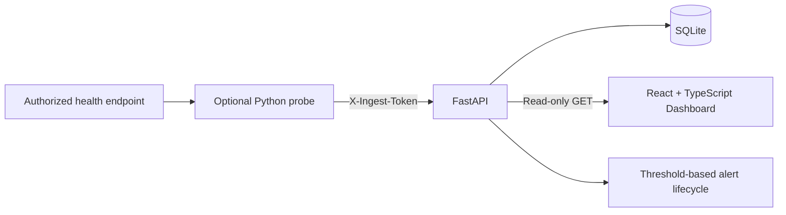

# InfraPulse — Full-Stack Infrastructure Monitoring Lab

**React · TypeScript · FastAPI · SQLite · HTTP probes · Automated incident detection**

InfraPulse is an educational infrastructure monitoring MVP with a responsive React dashboard, a Python REST API, persistent health samples, service-level latency thresholds and incident lifecycle management. It demonstrates full-stack integration and the fundamentals of reliability engineering; it is **not** a production monitoring solution.

## Features

- Dashboard showing monitored service count, health, active incidents, and total samples
- Clickable service cards and latency charts (Recharts), refreshing every 15 seconds
- API for service registration and submitting health/latency samples (token-protected writes)
- Automatic warning/critical alert creation on latency breaches or failed probes
- Deduplicated open alerts and automatic resolution after a healthy sample
- SQLite persistence for easy local setup, tests and container-free demo
- Optional polling collector for **only** health endpoints you own or are authorized to monitor

## Architecture



## Quick start

Requires Python 3.11+, Node.js 20+ and npm.

### API

```bash
python -m venv .venv
# activate the virtual environment, then:
pip install -r backend/requirements.txt
export INFRAPULSE_INGEST_TOKEN=replace-with-a-long-random-secret
uvicorn backend.app:app --reload --port 8000
```

On Windows PowerShell: `$env:INFRAPULSE_INGEST_TOKEN="replace-with-a-long-random-secret"`.

### Frontend

```bash
cd frontend
npm install
npm run dev
```

Open http://localhost:5173. API documentation: http://localhost:8000/docs.

### Create a service and record a sample

```bash
curl -X POST http://localhost:8000/api/services -H 'Content-Type: application/json' -H 'X-Ingest-Token: replace-with-a-long-random-secret' -d '{"name":"Demo API","description":"Locally monitored endpoint","latency_threshold_ms":300}'
curl -X POST http://localhost:8000/api/services/1/samples -H 'Content-Type: application/json' -H 'X-Ingest-Token: replace-with-a-long-random-secret' -d '{"ok":true,"latency_ms":86.5}'
```

Repeat with `{"ok":false,"latency_ms":1200}` to trigger an incident; a subsequent healthy sample resolves it. Do **not** put the ingestion token in React frontend code.

### Optional collector

```bash
python -m backend.collector --api http://localhost:8000 --service-id 1 --url http://localhost:8000/health --token replace-with-a-long-random-secret --interval 20
```

Only monitor URLs you control or have explicit authorization to probe.

## Tests

```bash
pip install pytest
python -m pytest -q tests
cd frontend && npm run build
```

## API

| Method | Endpoint | Access |
|---|---|---|
| GET | `/health` | Public |
| GET | `/api/summary` | Read-only |
| GET | `/api/services` | Read-only |
| GET | `/api/services/{id}/samples` | Read-only |
| GET | `/api/alerts?state=open` | Read-only |
| POST | `/api/services` | `X-Ingest-Token` |
| POST | `/api/services/{id}/samples` | `X-Ingest-Token` |

## Dockerized read-only demo preparation

A multi-stage [Dockerfile](Dockerfile) builds the React dashboard and serves the generated assets alongside FastAPI on one origin. See [deployment and security notes](DEPLOYMENT.md).

**Deployment status:** Docker build has been added to CI, but a successful frontend or image build has not yet been independently confirmed. No public InfraPulse service is deployed. Public containers should leave the ingestion secret unset so all writes fail closed.

## Current limitations

This is a **local developer MVP**. Storage is SQLite, not PostgreSQL; there is no multi-tenant login, distributed metrics broker, HTTPS termination, rate limiting, retention policy, query aggregation, or production alert delivery. The collector monitors only configured URLs; it is not a network scanner. The dashboard is read-only. Do not expose the write API publicly without production-grade authentication, secrets handling and network controls. Uptime is not inferred from a single sample and no SLA is claimed.

## Portfolio story

Built a React/TypeScript observability dashboard and FastAPI service supporting authenticated sample ingestion, SQLite-backed metric history, latency graphs and deduplicated incident creation/resolution. Designed and tested threshold logic and service-level data access in a local reliability-monitoring prototype.
